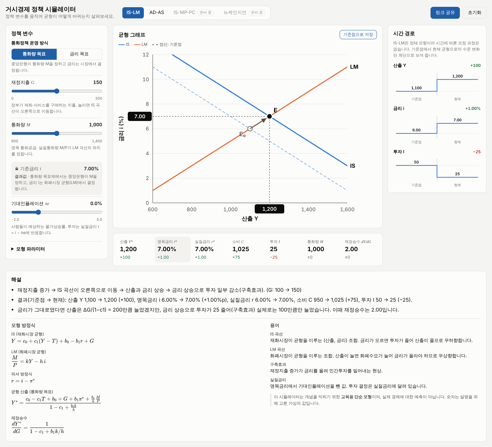

# 거시경제 정책 시뮬레이터

학부 거시경제학 수업용 웹 시뮬레이터입니다. 재정지출·통화량·기준금리·기대인플레이션을 슬라이더로 움직이면
IS-LM 균형이 어떻게 바뀌는지 그래프, 수준 변화, 한국어 해설로 바로 보여 줍니다.
시나리오는 URL에 저장되므로 링크로 공유할 수 있습니다.

> 개념을 익히기 위한 **교육용 단순 모형**이며, 실제 경제에 대한 예측이 아닙니다.



## 실행과 테스트

Node.js 22 이상이 필요합니다.

```bash
npm install
npm run dev        # 개발 서버
npm run build      # 타입 검사 + 프로덕션 빌드 (dist/)
npm run preview    # 빌드 결과 미리 보기
npm test           # Vitest 단위·속성 테스트
npm run lint       # oxlint
npm run smoke      # 빌드 후 실행: vite preview + Playwright 스모크 테스트, docs/screenshot-islm.png 갱신
```

`npm run smoke`는 설치된 `playwright` 패키지(로컬 또는 전역)와 Chromium을 사용하며, 브라우저를 내려받지 않습니다.

배포: `main`에 push하면 GitHub Actions가 빌드해 GitHub Pages에 올립니다(`.github/workflows/deploy.yml`).
Vite `base`는 환경변수 `BASE_PATH`로 정하며, 기본값은 상대 경로 `./`입니다.

## 구조

- `src/engine/` — 순수 TypeScript(React·DOM 의존 없음). 모형 정의와 해법. 각 모형은 `ModelDefinition`을 구현합니다:
  변수·파라미터 메타데이터, 정책 운영 방식(regime), 방식별로 잠기는 변수와 그 이유, `solve()`(균형값 + 곡선 좌표 + 선택적 시간 경로 + 경고),
  `explain()`(기준점 대비 변화 해설).
- `src/state/` — 시나리오 상태(모형, 운영 방식, 변수값, 기준점), `useReducer`용 리듀서, URL 쿼리스트링 직렬화.
- `src/ui/` — React 컴포넌트: 모형 탭, 정책 변수 패널, 균형 그래프(SVG 직접 작성), 시간 경로, 해설.

새 모형은 `src/engine/registry.ts`에 `ModelDefinition`을 등록하면 UI 셸을 바꾸지 않고 붙습니다.

## 모형 로드맵

1. **IS-LM** (구현됨) — 폐쇄경제, 물가 고정, 선형
2. **AD-AS** (준비 중)
3. **IS-MP-PC** (준비 중)
4. **뉴케인지언** (준비 중)

## IS-LM 모형

$$
\begin{aligned}
\text{IS:}\quad & Y = c_0 + c_1 (Y - T) + b_0 - b_1 r + G \\
\text{LM:}\quad & M / P = kY - h\,i \\
\text{피셔 방정식:}\quad & r = i - \pi^e
\end{aligned}
$$

통화량 목표제의 균형:

$$
Y^* = \frac{c_0 - c_1 T + b_0 + G + b_1 \pi^e + \frac{b_1}{h}\frac{M}{P}}{1 - c_1 + \frac{b_1 k}{h}},\qquad
i^* = \frac{kY^* - M/P}{h},\qquad r^* = i^* - \pi^e
$$

재정승수 $dY^*/dG = 1/(1 - c_1 + b_1 k/h)$, 통화승수 $dY^*/dM = \frac{b_1}{P h}\cdot dY^*/dG$.

금리 목표제에서는 중앙은행이 $i$를 정하므로 LM은 $i$에서 수평선이 되고, $Y$는 IS에서 $r = i - \pi^e$로 결정되며,
필요한 통화량 $M = P(kY - h\,i)$이 결과로 계산됩니다.

기본값: $c_0=200,\ c_1=0.75,\ T=100,\ b_0=200,\ b_1=25,\ G=100,\ M=1000,\ P=2,\ k=1,\ h=100,\ \pi^e=0$
→ $Y^*=1100,\ i^*=6\%$. 금리는 % 단위입니다.
