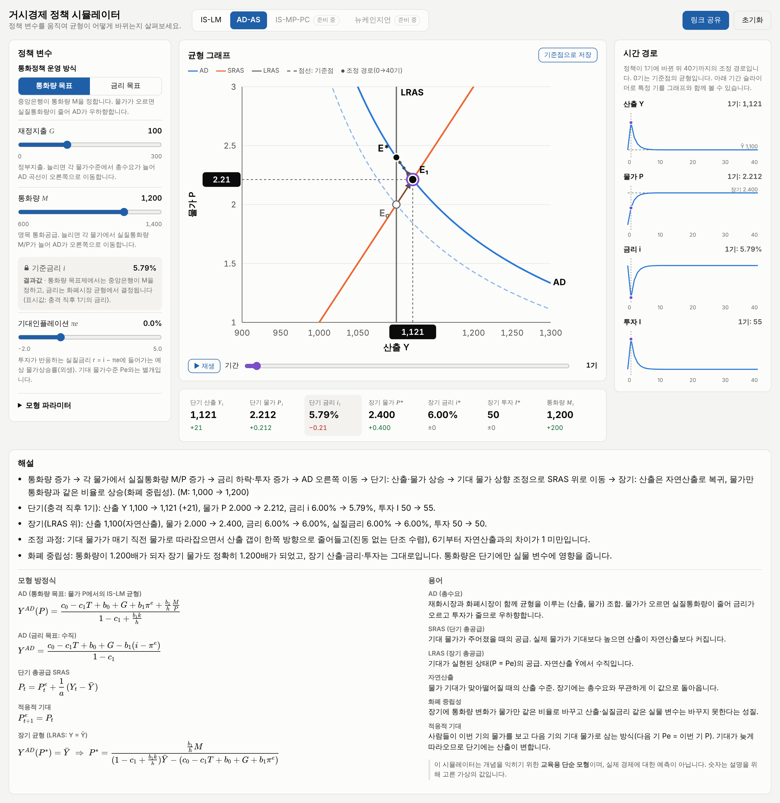
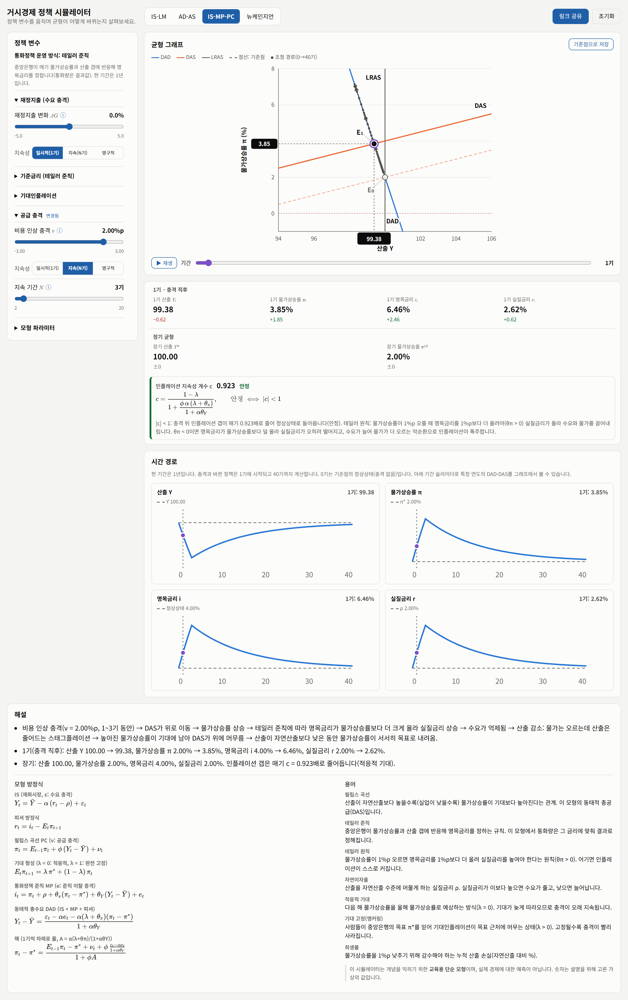
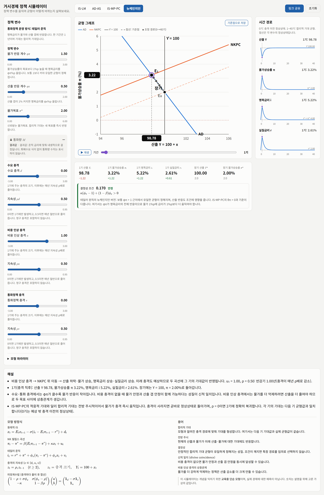

# 거시경제 정책 시뮬레이터

학부 거시경제학 수업용 웹 시뮬레이터입니다. 재정지출·통화량·기준금리·기대인플레이션을 슬라이더로 움직이면
IS-LM 균형, AD-AS의 단기·장기 조정 경로, IS-MP-PC(테일러 준칙과 필립스 곡선)의 동태가 어떻게 바뀌는지 그래프, 시간 경로, 한국어 해설로 바로 보여 줍니다.
시나리오는 URL에 저장되므로 링크로 공유할 수 있습니다.

> 개념을 익히기 위한 **교육용 단순 모형**이며, 실제 경제에 대한 예측이 아닙니다.








## 실행과 테스트

Node.js 22 이상이 필요합니다.

```bash
npm install
npm run dev        # 개발 서버
npm run build      # 타입 검사 + 프로덕션 빌드 (dist/)
npm run preview    # 빌드 결과 미리 보기
npm test           # Vitest 단위·속성 테스트
npm run lint       # oxlint
npm run smoke      # 빌드 후 실행: vite preview + Playwright, 네 모형의 docs/screenshot-*.png 갱신
```

`npm run smoke`는 개발 의존성 `playwright`와 설치된 Chromium을 사용하며, 실행 중 브라우저를 내려받지 않습니다.
최초 환경 설정에서만 `npx playwright install chromium`으로 브라우저를 설치합니다. 별도 위치는 `PLAYWRIGHT_BROWSERS_PATH`로 지정합니다.

배포: `main`에 push하면 GitHub Actions가 빌드해 GitHub Pages에 올립니다(`.github/workflows/deploy.yml`).
Vite `base`는 환경변수 `BASE_PATH`로 정하며, 기본값은 상대 경로 `./`입니다.

## 구조

- `src/engine/` — 순수 TypeScript(React·DOM 의존 없음). 모형 정의와 해법. 각 모형은 `ModelDefinition`을 구현합니다:
  변수·파라미터 메타데이터, 정책 운영 방식(regime), 방식별로 잠기는 변수와 그 이유, `solve()`(균형값 + 곡선 좌표 + 선택적 시간 경로 + 경고),
  `explain()`(기준점 대비 변화 해설). 동적 모형은 `Solution.trajectory`(기간별 균형점과 그 기의 곡선),
  `markers`(E₀·단기·장기 균형점), `kind: 'dynamic'` 시간 경로를 함께 돌려줍니다.
- `src/state/` — 시나리오 상태(모형, 운영 방식, 변수값, 기준점), `useReducer`용 리듀서, URL 쿼리스트링 직렬화(`model=` 포함).
  모형 탭을 바꾸면 두 모형에 모두 있는 변수(G, M, i, πe, 공통 파라미터)와 운영 방식은 그대로 유지됩니다.
  IS-MP-PC와 뉴케인지언은 다른 모형과 시나리오를 공유하지 않으므로(기대 형성과 충격 과정의 의미가 다름) 아무것도 넘기지 않고, 탭을 다시 열면 마지막 상태로 돌아갑니다.
- `src/ui/` — React 컴포넌트: 모형 탭, 정책 변수 패널, 균형 그래프(SVG 직접 작성), 시간 경로, 해설.

새 모형은 `src/engine/registry.ts`에 `ModelDefinition`을 등록하면 UI 셸을 바꾸지 않고 붙습니다.

## 모형 로드맵

1. **IS-LM** (구현됨) — 폐쇄경제, 물가 고정, 선형
2. **AD-AS** (구현됨) — 물가 내생, 적응적 기대, 40기 조정 경로
3. **IS-MP-PC** (구현됨) — 테일러 준칙, 필립스 곡선, 기대 고정 정도 λ, 수요·정책·공급·기대 충격, 40년 경로
4. **뉴케인지언** (구현됨) — 합리적 기대, 전방 주시 IS·NKPC, AR(1) 충격과 결정성 조건

## IS-LM 모형

$$
\begin{aligned}
\text{IS:}\quad & Y = c_0 + c_1 (Y - T) + b_0 - b_1 r + G \\
\text{LM:}\quad & M / P = kY - h\,i \\
\text{피셔 방정식:}\quad & r = i - \pi^e
\end{aligned}
$$

통화량 목표제의 균형:

$$
Y^* = \frac{c_0 - c_1 T + b_0 + G + b_1 \pi^e + \frac{b_1}{h}\frac{M}{P}}{1 - c_1 + \frac{b_1 k}{h}},\qquad
i^* = \frac{kY^* - M/P}{h},\qquad r^* = i^* - \pi^e
$$

재정승수 $dY^*/dG = 1/(1 - c_1 + b_1 k/h)$, 통화승수 $dY^*/dM = \frac{b_1}{P h}\cdot dY^*/dG$.

금리 목표제에서는 중앙은행이 $i$를 정하므로 LM은 $i$에서 수평선이 되고, $Y$는 IS에서 $r = i - \pi^e$로 결정되며,
필요한 통화량 $M = P(kY - h\,i)$이 결과로 계산됩니다.

기본값: $c_0=200,\ c_1=0.75,\ T=100,\ b_0=200,\ b_1=25,\ G=100,\ M=1000,\ P=2,\ k=1,\ h=100,\ \pi^e=0$
→ $Y^*=1100,\ i^*=6\%$. 금리는 % 단위입니다.

## AD-AS 모형

IS-LM의 재화·화폐시장을 그대로 쓰되 물가 $P$가 결과로 정해지고, 시간이 등장합니다.

$$
\begin{aligned}
\text{AD (통화량 목표):}\quad & Y^{AD}(P) = \frac{c_0 - c_1 T + b_0 + G + b_1 \pi^e + \frac{b_1}{h}\frac{M}{P}}{1 - c_1 + \frac{b_1 k}{h}} \;=\; \alpha + \frac{\beta}{P} \\
\text{SRAS:}\quad & P_t = P^e_t + \tfrac{1}{a}\,(Y_t - \bar Y) \\
\text{적응적 기대:}\quad & P^e_{t+1} = P_t \\
\text{LRAS:}\quad & Y = \bar Y
\end{aligned}
$$

매기 AD와 SRAS의 교점을 정확히 풉니다. 두 식을 합치면 $P$에 대한 이차방정식
$aP^2 + (\bar Y - aP^e_t - \alpha)P - \beta = 0$이 되고($\beta > 0$), 양의 근은 하나뿐입니다.
그다음 $i_t = (kY_t - M/P_t)/h$, $r_t = i_t - \pi^e$, $I_t$, $C_t$를 계산합니다.

- 0기는 기준점의 장기 균형($Y = \bar Y$, $P^e = P$)이고, 바뀐 정책은 1기부터 적용되어 40기까지 시뮬레이션합니다.
- 장기 균형: $P^* = \beta / (\bar Y - \alpha)$. $M$을 $\lambda$배 하면 $P^*$도 $\lambda$배가 되고
  $Y$, $i$, $r$, $I$는 그대로입니다(화폐 중립성). 재정지출을 늘리면 장기에 $Y = \bar Y$로 돌아오고 $P$와 $i$는 오르며, 투자는 $\Delta G$만큼 줄어듭니다(완전 구축).
- 통화량 목표제에서 조정은 **단조 수렴**입니다. $P_t$는 진동 없이 한쪽에서 $P^*$로 다가가며,
  산출 갭은 기본값 근처에서 매기 대략 $1/(1 + \beta/(aP^{*2}))$배로 줄어듭니다(기본값에서 약 0.44).
- 금리 목표제에서는 중앙은행이 $i$를 고정하고 $M$이 결과로 정해지므로 AD가
  $Y = [c_0 - c_1T + b_0 + G - b_1(i - \pi^e)]/(1 - c_1)$에서 **수직**입니다.
  이 값이 $\bar Y$와 다르면 물가가 매기 $(Y - \bar Y)/a$씩 끝없이 움직입니다. 이 모형에서 금리 고정은
  물가를 붙잡아 둘 닻이 없고, 화면에도 이 경고가 표시됩니다(다음 단계 IS-MP-PC의 테일러 준칙으로 이어짐).
  물가가 0 이하로 떨어지면 그 기간부터는 계산하지 않습니다.

기본값: IS-LM과 같은 파라미터에 $a = 100$(SRAS 기울기 $1/a = 0.01$), $\bar Y = 1100$
→ 초기 정상상태 $Y = \bar Y = 1100,\ P = P^e = 2,\ i = 6\%$.

## IS-MP-PC 모형

교과서(맨큐)의 동태적 AD-AS 모형에 기대 고정 정도 $\lambda$와 준칙 이탈 충격 $e$를 더했습니다.
모든 변수는 % 단위이고($\bar Y = 100$이면 산출을 자연산출 대비 %로 읽음), **한 기간은 1년**입니다.

$$
\begin{aligned}
\text{IS:}\quad & Y_t = \bar Y - \alpha (r_t - \rho) + \varepsilon_t \\
\text{피셔 방정식:}\quad & r_t = i_t - E_t\pi_{t+1} \\
\text{필립스 곡선:}\quad & \pi_t = E_{t-1}\pi_t + \phi (Y_t - \bar Y) + \nu_t \\
\text{기대:}\quad & E_t\pi_{t+1} = \lambda \pi^* + (1-\lambda)\pi_t \qquad (\lambda = 0\text{: 적응적},\ \lambda = 1\text{: 완전 고정}) \\
\text{통화정책 준칙:}\quad & i_t = \pi_t + \rho + \theta_\pi(\pi_t - \pi^*) + \theta_Y (Y_t - \bar Y) + e_t
\end{aligned}
$$

기본값: $\bar Y = 100,\ \pi^* = 2,\ \rho = 2,\ \alpha = 1,\ \phi = 0.25,\ \theta_\pi = 0.5,\ \theta_Y = 0.5,\ \lambda = 0$
→ 정상상태 $Y = 100,\ \pi = 2,\ i = 4,\ r = 2$.

**매기 닫힌 해.** $x_t = \pi_t - \pi^*$, $g_t = Y_t - \bar Y$, $u_t = E_{t-1}\pi_t - \pi^*$로 두면 준칙과 기대를 피셔 방정식에 넣어
$r_t - \rho = (\lambda + \theta_\pi)x_t + \theta_Y g_t + e_t$이고, IS와 합치면 동태적 총수요(DAD)

$$
g_t = s_t - A x_t,\qquad s_t = \frac{\varepsilon_t - \alpha e_t}{1 + \alpha\theta_Y},\qquad A = \frac{\alpha(\lambda + \theta_\pi)}{1 + \alpha\theta_Y}
$$

를 얻습니다($\lambda + \theta_\pi > 0$이면 우하향, $= 0$이면 수직, $< 0$이면 우상향). 필립스 곡선(DAS) $x_t = u_t + \nu_t + \phi g_t$와 연립하면

$$
x_t = \frac{u_t + \nu_t + \phi s_t}{1 + \phi A},\qquad u_{t+1} = (1-\lambda)\,x_t
\;\Rightarrow\; x_t = c\,x_{t-1} + (\text{충격 항}),\qquad c = \frac{1-\lambda}{1 + \phi A}.
$$

- **안정 조건**: $|c| < 1$, 즉 $|1-\lambda| < \left|1 + \dfrac{\phi\alpha(\lambda+\theta_\pi)}{1+\alpha\theta_Y}\right|$.
  $\lambda = 0$이면 $c = 1/(1 + \phi\alpha\theta_\pi/(1+\alpha\theta_Y))$이고 안정 ⇔ $\theta_\pi > 0$(**테일러 원칙**).
  기본값에서 $c \approx 0.9231$, $\theta_\pi = -0.5$이면 $c \approx 1.0909$(발산). $\theta_\pi = 0$이면 $c = 1$로 갭이 사라지지 않습니다.
  $\lambda > 0$이면 실질금리가 물가 1%p당 $\lambda + \theta_\pi$만큼 움직이므로 조건이 $\theta_\pi > -\lambda$로 완화되고, $\lambda = 1$이면 $c = 0$이어서
  일시적 충격이 끝난 바로 다음 해에 목표로 돌아옵니다.
- 0기는 **기준점의 정상상태**(충격 없음)이고, 충격과 바뀐 정책은 1기부터 적용되어 40기까지 계산합니다.
  물가목표 $\pi^*$를 기준점보다 낮추면 경제는 옛 목표의 정상상태에서 출발합니다(1기 기대 = 옛 목표): 디스인플레이션 실험이며, 해설에 희생률(누적 산출 손실 ÷ 인플레이션 하락폭)을 보여 줍니다.
- 충격: 재정지출 변화 $\Delta G$(자연산출 대비 %, $\varepsilon_t = \Delta G\cdot\bar Y/100$), 준칙 이탈 $e$, 비용 인상 $\nu$는 각각 일시적(1기)·지속(N기)·영구적 중에서 고르고,
  기대 충격은 1기의 $E_0\pi_1$만 옮깁니다. 영구적 충격이 있으면 장기값은 $x^* = (\nu + \phi s)/(\lambda + \phi A)$, $g^* = s - A x^*$입니다
  (준칙의 $\rho$가 고정되어 있어 영구적 수요 충격은 물가상승률을 목표와 다르게 남깁니다).
- 통화량은 조작 변수가 아닙니다. 중앙은행이 준칙으로 금리를 정하고 통화량은 그 금리에 맞춰 내생적으로 정해지며, 이 모형은 화폐수요를 따로 두지 않으므로 값을 표시하지 않습니다.
- 불안정한 경우에도 그대로 계산하되, 그래프 범위는 앞의 8기에만 맞추고 물가상승률 갭이나 산출 갭이 50을 넘는 기간부터는 그리지 않으며 경고를 띄웁니다.

## 뉴케인지언 모형

3방정식 뉴케인지언 모형이며 **한 기간은 1년**, 금리·물가상승률·산출 갭은 % 단위입니다. $x_t = Y_t - 100$입니다.

$$
\begin{aligned}
\text{동태적 IS:}\quad &x_t = E_t x_{t+1} - \sigma(i_t-E_t\pi_{t+1}-r^n)+d_t \\
\text{NKPC:}\quad &\pi_t-\pi^* = \beta(E_t\pi_{t+1}-\pi^*)+\kappa x_t+u_t \\
\text{테일러 준칙:}\quad &i_t = r^n+\pi^*+\phi_\pi(\pi_t-\pi^*)+\phi_x x_t+v_t \\
\text{충격:}\quad &z_t=\rho_z z_{t-1}\ (t\ge2),\quad z_1=\text{충격 크기},\quad z\in\{d,u,v\}
\end{aligned}
$$

**합리적 기대의 닫힌 해(미정계수법).** 충격별로 $x_t=a z_t$, $\pi_t-\pi^*=b z_t$를 두면 다음 기 기대는 각각 $\rho a z_t$, $\rho b z_t$입니다.

$$
\begin{pmatrix}
1-\rho+\sigma\phi_x & \sigma(\phi_\pi-\rho) \\
-\kappa & 1-\beta\rho
\end{pmatrix}
\begin{pmatrix}a\\b\end{pmatrix}
=\begin{pmatrix}\mathbf1_d-\sigma\mathbf1_v\\\mathbf1_u\end{pmatrix}.
$$

충격 세 개의 해를 더해 1~40기를 계산합니다. $|\det|<10^{-9}$이면 해를 보고하지 않고 경고합니다.
0기는 기준점의 충격 없는 정상상태이며, 새 정책과 예상 밖 충격은 1기에 적용됩니다. 미래 기대는 새 정책을 즉시 반영합니다.
그래프 AD와 NKPC는 각 기의 기대값을 고정하고 그리므로 그 기의 균형점에서 정확히 만납니다.
$\phi_\pi>0$이면 AD는 우하향하고, $\phi_\pi=0$에서는 수직입니다. NKPC는 우상향합니다.

**결정성 조건:**

$$\kappa(\phi_\pi-1)+(1-\beta)\phi_x>0.$$

테일러 원칙의 뉴케인지언 버전으로 보통 $\phi_\pi>1$ 근처입니다. IS-MP-PC의 $\theta_\pi>0$은 물가에 대한 명목금리 반응이 $1+\theta_\pi$인 준칙의 조건입니다.
여기서는 전체 반응이 $\phi_\pi$이므로 기준이 다릅니다. 조건이 음수거나 수치상 경계($|값|<10^{-9}$)이면 유일한 균형을 선택할 수 없어 경로·장기값을 표시하지 않습니다.

기본값: $\beta=0.96,\ \sigma=1,\ \kappa=0.3,\ \phi_\pi=1.5,\ \phi_x=0.5,\ \pi^*=2,\ r^n=2$,
충격은 0, 각 지속성은 0.5입니다. 결정성 값은 **0.170**, 정상상태는 **Y = 100, π = 2%, i = 4%, r = 2%**입니다.
실질금리는 $r_t=i_t-E_t\pi_{t+1}$로 계산합니다. $\rho=0$이면 2기에 정확히 복귀하며, 양의 지속성에서는 반감기가 $\ln(0.5)/\ln(\rho)$년입니다.

비용 충격이 없으면 물가 안정과 산출 갭 안정이 함께 가능하다는 성질을 **신적 일치**라고 합니다. 비용 인상 충격에서는 물가 안정과 산출 사이에 상충관계가 생깁니다.
IS-MP-PC의 적응적 기대와 달리 기대가 전방 주시적이므로 충격이 사라진 뒤 별도의 기대 조정 지연이 남지 않습니다.
제로금리 하한, 비선형성, 불확실한 충격 경로와 비기본적 균형은 이번 범위에 포함하지 않습니다.
